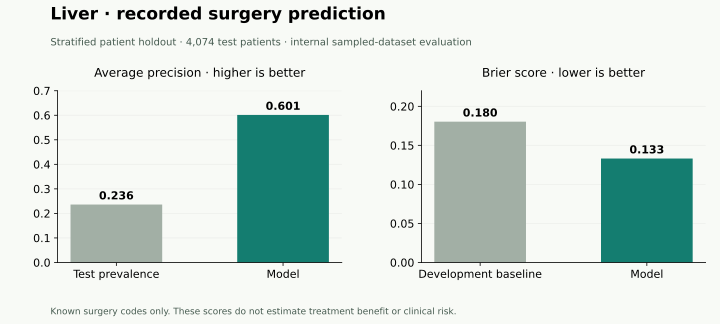

# Liver cancer: a stage-aware care-pattern case study

The Liver extract supports a stage-aware analysis because it contains Combined Summary Stage (2004+). The other four coursework cohorts have no usable stage field. This makes Liver a useful methodological showcase; it does not establish a more accurate clinical model or treatment recommendation.

## Refreshed patient-holdout results

The regularized logistic regression predicts **recorded primary-site surgery among known 00 / 01–90 codes**. It uses age-band midpoint, recorded sex, grade, area income, and source summary stage. Unknown/other surgery codes are excluded.

| Measure | Patient holdout | Temporal sensitivity |
| --- | ---: | ---: |
| Test patients | 4,074 | 5,578 |
| Surgery recorded in test | 962 | 1,365 |
| Test prevalence / random-ranking AP baseline | 0.236 | 0.245 |
| Average precision | 0.601 | 0.599 |
| ROC AUC | 0.823 | 0.817 |
| Brier score (lower is better) | 0.133 | 0.139 |

The primary ROC AUC has a 95% percentile bootstrap interval of **0.809–0.836**, from 1,000 resamples of the fixed model's held-out patients (seed 20261016). This interval describes test-sample uncertainty, not training/model-selection uncertainty or population validity. Primary average precision is 2.55 times its test prevalence baseline. The constant-probability baseline, fixed at development prevalence, has Brier 0.180 versus model Brier 0.133.



The two designs use different, overlapping source populations. Their score differences do not establish an improvement caused by the new split. AUC describes ranking; calibration must be assessed separately. No clinical decision threshold or utility is established.

## How the evaluation works

There are 20,370 model-eligible index patients, including 16,296 in development and 4,074 in test. The reproducible 80/20 split is stratified by surgery recording. Five development-only folds select regularization by mean average precision; preprocessing is learned within each fold. The final model fits development only. The year-based design remains a secondary sensitivity analysis.

The 2010–2017 eligibility window retains the existing legacy-grade source era; it no longer determines the primary train/test assignment. Extending the era requires predictor harmonization. Descriptive summaries cover all 64,491 earliest-index Liver patients, so their denominator differs from model evaluation.

## Separate all-cause survival analysis

The Cox model uses a separate death-status-stratified patient split. It predicts all-cause survival, not suicide or treatment benefit. Its test C-index is **0.698** on 4,119 patients.

| Horizon | Cox IPCW Brier | Development KM baseline | Test patients at risk |
| --- | ---: | ---: | ---: |
| 1 year | 0.192 | 0.249 | 2,048 |
| 3 year | 0.162 | 0.201 | 1,148 |
| 5 year | 0.132 | 0.161 | 686 |

All three displayed horizons passed the existing censoring and at-risk support rules. Stratification does not remove informative censoring or differences in follow-up.

## Scope and reproducibility

These are **revised internal evaluations of the supplied sampled dataset**, not validated clinical or population risk estimates. Earlier project findings were already inspected, so this resplit is not independent confirmatory validation. Stage may include information recorded after a proposed clinical decision point; predictor timing has not been verified. Treatment recording is incomplete, area income is contextual, and important confounders are unavailable.

The [public interactive demo](https://kashishchaudhari.github.io/cancer-survivorship/) opens on Liver and contains invented values only. This report and the [whole-cohort results](RESULTS_SUMMARY.md) contain the real aggregate findings requested for this update; raw records, predictions, trained models, and subgroup results stay local. See the [study design](TREATMENT_MODEL.md) for model eligibility and evaluation details.

To reproduce the fixed-model interval after building the real-data studies locally:

```powershell
uv run python scripts/evaluate_liver_uncertainty.py --folder "C:\approved\Datasets" --studies .runtime/patient-studies
```
