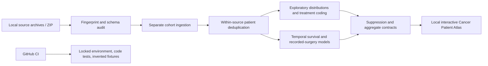

# Project brief: Cancer Patient Atlas

## Portfolio question

Can we build a reproducible, privacy-aware analytics product that explains variation in recorded cancer care and evaluates what historical data can predict, while clearly showing where the data cannot answer clinical questions?

## Why this is a strong healthcare data-science case study

The project demonstrates registry-style ingestion, patient-level deduplication, source fingerprinting, distinct cancer cohorts, rare and censored outcome evaluation, treatment-code quality, temporal model validation, calibration, subgroup checks, dashboard interaction design, and privacy-safe automation. The most valuable decision is the restraint: it does not turn confounded treatment codes into a false “best treatment” recommender.

## Analysis tracks

1. **Recorded care and treatment assignment:** four CancerProject2025 cohorts plus a separate Liver raw extract. Interactive distributions expose spread, missingness, timing and treatment coding; a temporal model predicts whether surgery was recorded among known surgery codes.
2. **Survival outcomes:** separate all-cause Kaplan–Meier and temporally evaluated Cox model for each cancer study, with held-out calibration, an IPCW Brier comparison, and subgroup performance.
3. **Survivorship suicide outcome research:** maintained as a distinct raw-extract analysis because its endpoint, eligible population and earlier sample-based workbook are different from the treatment and all-cause tracks. It must not be folded into a single cancer risk score.

## Data boundaries that shape the product

Brain, Breast, Prostate, and Skin coursework exports do not contain usable stage. The Liver raw extract contains `Combined Summary Stage (2004+)`, so stage analysis and stage-aware modeling are specific to that study and source era. The project does not infer stage from grade or TNM labels. Area income is not a patient's income. Surgery, radiation and chemotherapy codes describe what was recorded. Unknown and no/unknown codes do not establish untreated status.

## Delivery pipeline

Source reading, model fitting, real results, and dashboard data stay local. GitHub CI cannot see the source archives, patient-level rows, model artifacts, or real-data aggregates. The workflow does not deploy Pages or upload artifacts.

## Recruiter review checklist

- **Study design:** explain source reconciliation, unit of analysis, index diagnosis, temporal split, and why cohorts stay independent.
- **Modeling:** show the prevalence baseline beside average precision, grouped calibration, Brier score and ROC AUC; explain what each metric can and cannot tell us.
- **Healthcare judgment:** distinguish observed assignment from treatment benefit; describe missing confounders and what study design would be needed for a comparative-effectiveness claim.
- **Product:** use each chart to answer a specific question; keep filters scoped to a cancer; show denominators, uncertainty, missingness, and stage availability in context.
- **Privacy:** publish code, method, and invented examples only until permission for a defined result is confirmed.

See [the treatment model study design](TREATMENT_MODEL.md) for target construction, split rules, metrics and causal limits. The local [dataset card](DATASET_CARD.md) documents source schema and populations.
