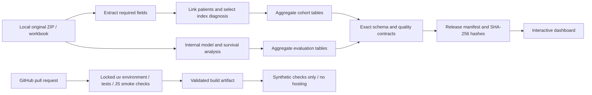

# Survivorship Observatory

Target role: **healthcare data scientist**. Build a reproducible research product that pairs rare-event evaluation with a compelling, traceable dashboard.

## The hiring story

Question: How do recorded suicide outcomes, outcome availability, and mortality patterns vary across the supplied cancer extracts, and how well do exploratory models rank outcomes on an internal patient-held-out sample?

The value is the complete delivery chain: source reconciliation, patient grouping, honest denominators, appropriate metrics for uncommon events, competing-risk interpretation, and tested deployment. This is an internal evaluation of supplied data, not validated clinical or population risk estimation.

## Architecture



Raw data ingestion and training run locally. Hosted CI rebuilds and validates versioned aggregate tables. A CI build timestamp is not a source refresh timestamp. No patient data is needed on GitHub runners.

## Milestones and acceptance criteria

| Milestone | Deliverable | Acceptance |
| --- | --- | --- |
| 1. Engineering foundation | Contracts, manifests, checks, synthetic CI workflow, pipeline dashboard view | All nine tables and care metadata validate; failure blocks release; tabs and charts initialize |
| 2. Data-science evaluation | Development-only model selection; untouched temporal or patient holdout; calibration and subgroup uncertainty | Model card states endpoint, observation window, sampling, leakage exclusions, split rules, metrics and limitations; no tuning on final holdout |
| 3. Creative decision narrative | Outcome-coverage map, age/site comparison, model precision-recall explorer, research notes | Every visual shows population and denominator; filters are scoped; mobile and empty-state checks pass |
| 4. Portfolio delivery | Code-only repository, architecture, synthetic screenshots, short case study and demo script | CI uses invented fixtures; no restricted data, results or history uploaded; public examples are labeled synthetic |

Milestone 1 is implemented locally. The care-equity audit and descriptive dashboard are also implemented; see [the research module](CARE_EQUITY.md). Real-data hosting is disabled. GitHub execution is not yet verified because no remote is configured. Existing Git history contains results and must not be pushed; use a reviewed fresh code-only export. Stronger model validation, uncertainty exploration and portfolio delivery remain planned.

## Dashboard experience

Seven views: **KPI observatory**, **Exploratory profile**, **Survival & competing risks**, **Model evaluation**, **Care & equity**, **Pipeline & quality**, and **Data & reliability**. The KPI observatory is the opening research brief; its definition and visual rationale are in [the design notes](KPI_DESIGN.md). Keep study populations visible and separate. Make the model story about average precision relative to event prevalence, calibration, and uncertainty rather than accuracy alone.

Implemented visual upgrade: a cancer-site × age heatmap with a switch between outcome coverage and recorded-outcome fraction, tooltips showing events and known-outcome counts, and an explicit sparse-group label. Next: add an internal model comparison explorer using existing bootstrap intervals before adding more algorithms.

## Publication boundary

The build accepts nine exact aggregate CSV schemas and allowlisted care metadata, and packages only the dashboard assets and those inputs. It excludes raw archives, patient identifiers, predictions, models and local runtime files. Care counts below 11 are withheld, but aggregation and suppression alone do not establish redistribution permission or formal anonymization. Before public publication, confirm supplied-data sharing conditions and review disclosure across the full release.

## Run and preview

```powershell
uv sync --locked
uv run python -m pytest -q
uv run python scripts/build_dashboard_static.py --source dashboard/data --target .runtime/site
node scripts/check_dashboard.mjs --site .runtime/site
uv run python -m http.server 8765 --bind 127.0.0.1 --directory .runtime/site
```

Open http://127.0.0.1:8765. For a local aggregate refresh, first run the existing raw-archive aggregation and analysis scripts, then build using `--source outputs`. Refresh local ignored dashboard inputs after review; real results remain confidential.

## Activate CI/CD

Prepare a fresh code-only repository from the reviewed export. Do not push the original history. The workflow checks synthetic fixtures and code only; artifact uploads and Pages deployment are disabled. Real-data hosting or disclosure requires specific permission. See DATA_PRIVACY.md.

The workflow does not train models on every commit and does not fabricate scheduled data refreshes for a fixed historical dataset. New data requires an actual local refresh and reviewed aggregate update.
