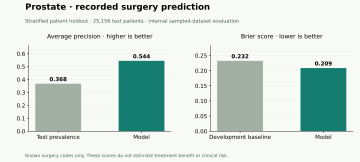

# Prostate cancer: care patterns and held-out evaluation

The supplied source contains 624,498 records and 624,327 earliest-index patients. This coursework source has no usable stage field. Stage is excluded; grade is not a stage proxy.

## Recorded-surgery model

The model predicts whether primary-site surgery is recorded among known codes: 00 versus 01–90. Unknown/other codes are excluded. Inputs: age_mid, sex, grade, income.

| Measure | Patient holdout | Temporal sensitivity |
| --- | ---: | ---: |
| Test patients | 25,156 | 33,410 |
| Surgery recorded in test | 9,249 | 11,742 |
| Test prevalence / random-ranking AP baseline | 0.368 | 0.351 |
| Average precision | 0.544 | 0.527 |
| ROC AUC | 0.695 | 0.697 |
| Brier score (lower is better) | 0.209 | 0.207 |

Primary ROC AUC has a 95% percentile bootstrap interval of **0.688–0.701** from 1,000 fixed-model test-patient resamples (seed 20261016). This excludes training and model-selection uncertainty. Average precision is 1.48 times its own test prevalence baseline. The constant-probability baseline, fixed at development prevalence, has Brier 0.232.



Development contains 100,622 eligible patients. Five development-only folds select regularization, with preprocessing fitted within each training fold; the final model fits development only. The primary 80/20 patient split is reproducible (seed 20261014). Eligibility remains 2010–2017 for the existing legacy-grade source era; years no longer assign the primary partitions.

The temporal sensitivity uses different, overlapping source populations. Score differences do not establish improvement caused by a split change. High average precision can partly reflect high surgery prevalence; it must be compared with the baseline. Cross-cancer scores are not a fair ranking of clinical performance.

## Separate all-cause survival model

The penalized Cox model has test C-index **0.747** on 25,479 patients. Its separate patient split is stratified by death status; development folds select regularization by concordance.

| Horizon | Cox IPCW Brier | Development KM baseline | Test patients at risk |
| --- | ---: | ---: | ---: |
| 1 year | 0.032 | 0.036 | 24,372 |
| 3 year | 0.074 | 0.091 | 22,576 |
| 5 year | 0.106 | 0.132 | 18,255 |

## Interpretation and reproducibility

These are **revised internal evaluations of the supplied sampled dataset**, not validated clinical or population risk estimates. Earlier findings were inspected; this resplit is not independent confirmatory validation. Treatment codes are incomplete, predictor availability at a clinical decision time is unverified, area income is contextual, and confounding and informative censoring remain. No treatment-benefit or individualized recommendation is established.

The public dashboards use invented values only. This report contains whole-cohort aggregates; raw records, predictions, trained models, and subgroup results stay local.

See the [study design](TREATMENT_MODEL.md), [all five case studies](CASE_STUDIES.md), and [original dashboard](https://kashishchaudhari.github.io/cancer-survivorship/observatory/).

```powershell
uv run python scripts/evaluate_cohort_uncertainty.py --cohort Prostate --folder "C:\approved\Datasets" --studies .runtime/patient-studies --output .runtime/prostate-uncertainty.json
```
